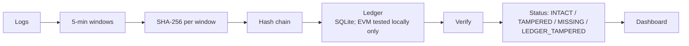

# SentinelVault — Tamper-Proof Security Log Vault

**Prove your logs are the ones you originally wrote — even against an attacker with full root access.**

Graphite 26 · Problem Statement 9 · Cybersecurity track.


---

## What it does

After a breach, attackers (or a malicious insider with admin rights) often **edit or delete the logs** to hide their tracks, and nobody can later prove the logs were changed. SentinelVault takes a **fingerprint** (a SHA-256 hash) of the logs every few minutes and stores those fingerprints in an **append-only** record the admin can't quietly rewrite. Later, anyone can re-check the current logs against the stored fingerprints and see **exactly which time window was edited, deleted, or is missing** — and when the original was recorded.

**How it works, in plain words:**
- The log is split into fixed **5-minute windows**.
- Each window gets a fingerprint, and each fingerprint includes the previous one — like links in a chain, so you can't change one without breaking the next.
- Fingerprints are stored append-only (a local database that blocks edits/deletes, or an on-chain smart contract).
- To check, SentinelVault re-reads the log, re-fingerprints it, and compares — flagging each window and pointing at the first break.

---

## Architecture



Logs are split into fixed 5-minute windows, each window is fingerprinted with SHA-256, and each fingerprint is chained to the previous one so a single change breaks the chain. The fingerprints are stored in an append-only ledger — a local SQLite store for the offline demo, or an EVM smart contract (tested on a local chain only). To check, Verify re-reads the current log, re-fingerprints it, compares against the ledger, and reports each window's status to the dashboard.

---

## Key features

- **Chained SHA-256 fingerprints** per 5-minute window — deterministic and tamper-evident (change one window and the chain breaks).
- **Append-only storage** — a local SQLite ledger with UPDATE/DELETE blocked by database triggers, or a real EVM smart contract.
- **Precise verifier** — flags each window as INTACT / TAMPERED / MISSING / UNANCHORED / LEDGER_TAMPERED and pinpoints the first break.
- **Hardened API** — API-key auth, rate limiting, and security headers on every response, with a live `/docs` page.
- **Demo-ready** — one-command reset/anchor/tamper flow, a simulated SOC alert, Docker support, and CI that runs the tests on every push.

---

## How to run (from a fresh clone)

Needs **Python 3.13**. All commands below were run and confirmed on Windows (PowerShell); they work the same in bash.

```bash
# 1. install dependencies
pip install -r requirements.txt

# 2. create the demo working log + an empty ledger
python src/vault.py init-demo

# 3. start the API on http://localhost:8000
python -m uvicorn src.server:app --reload
```

When the server starts you should see:
`[INFO] Ledger running in LOCAL APPEND-ONLY mode (mock: true).`
Then open **http://localhost:8000/docs** to click the endpoints in your browser.

**Run the tests:**

```bash
python -m pytest -q
```

Expected: **24 passed**.

> **Tested this session:** `pip install`, `init-demo`, the server startup, and `pytest` (24 passed) all ran and worked. The only snag: the server couldn't bind `:8000` while another copy was already running locally — stop the old one first, or use `--port 8001`.
> **NOT TESTED this session:** Docker (`docker compose up --build`) and EVM/testnet mode — see the honesty section below.

---

## Run the dashboard (frontend)

The repo also ships a React dashboard (in `frontend/`) that talks to the backend above. **Start the backend first** (so it is listening on `http://localhost:8000`), then in a second terminal:

```bash
cd frontend
npm install
npm run dev
```

Open **http://localhost:5173** in your browser.

- By default the dashboard calls the real backend at `http://localhost:8000` (override with `VITE_API_BASE`).
- **`VITE_MOCK_MODE` must stay off for the real demo.** It is off by default. If it is set to `true`, the dashboard simulates everything in the browser and shows a bright `⚠ MOCK DATA — NOT the real backend` banner. That mode is an offline fallback only — never use it for the real demo.

**What the dashboard shows:**
- **Attack console** — run the three attacker actions against a chosen window: *modify* a line, *delete* a line, or *delete the whole window*.
- **Inspector** — per window, the **anchored hash vs the current hash** side by side, the **originally recorded** time (when the window was anchored) and the **first noticed** time (when tampering was first detected), and the window's status.
- **Siren** — a ~3-second alert siren plays when verify detects tampering; muting stops it and it never overlaps itself.

> Tested by the team after a fresh restart; see `STATUS.md`.

---

## Demo steps (local mode)

You can drive the demo from the browser at **/docs**, from `curl`, or from the CLI. The flow:

```bash
# A. reset to a clean, known state
python src/vault.py init-demo        # (or POST /api/reset-demo)

# B. record the fingerprints of the current log  → 3 windows
python src/vault.py anchor

# C. confirm everything is clean
python src/vault.py verify           # Overall: INTACT

# D. simulate an attacker tampering with the log, then re-check
python src/vault.py tamper-demo --window-index 0 --action modify
python src/vault.py verify           # Window 0 now TAMPERED
```

**Three attacker actions** are available on `POST /api/tamper-demo`:

| Action | What it does | Next verify shows |
|---|---|---|
| `modify` | changes one line in the window | that window **TAMPERED** |
| `delete` | removes one line from the window | that window **TAMPERED** |
| `delete_window` | removes **every** line of the window | that window **MISSING** |

> `modify` and `delete` are available on both the CLI and the HTTP API. **`delete_window` is HTTP-only** (via `/docs` or curl), e.g.:
> ```bash
> curl -X POST http://localhost:8000/api/tamper-demo \
>   -H "X-API-Key: demo-key-123" -H "Content-Type: application/json" \
>   -d '{"window_index": 1, "action": "delete_window"}'
> ```

**What each status means:**

| Status | Meaning |
|---|---|
| `INTACT` | The window matches its stored fingerprint — unchanged. |
| `TAMPERED` | The window is still there, but its content changed (a line edited or removed). |
| `MISSING` | The whole window was deleted from the current log. |
| `UNANCHORED` | A window exists in the log now that was never fingerprinted (e.g. newer logs since the last anchor). |
| `LEDGER_TAMPERED` | The stored record itself was altered — its own chain hash no longer matches its fields, or its link to the previous window is broken. |

> **Important rule:** the stored fingerprints describe one exact version of the log. **If the sample/working log changes, run `init-demo` (reset) and `anchor` again before demoing** — otherwise verify will correctly report the old fingerprints as TAMPERED/MISSING against the new file.

---

## Environment variables

All have safe defaults, so the local demo needs none of them.

| Variable | Meaning | Default |
|---|---|---|
| `LOG_PATH` | working log file the API reads | `data/server.log` |
| `DB_PATH` | local ledger database file | `data/ledger.sqlite` |
| `LEDGER_BACKEND` | `local` or `testnet` (picks the anchor; also sets `mock`) | `local` |
| `WINDOW_SECONDS` | window size in seconds | `300` |
| `FRONTEND_ORIGIN` | allowed CORS origins (comma-separated) | `http://localhost:5173,http://localhost:5174` |
| `VAULT_API_KEY` | key required in the `X-API-Key` header on POST requests | `demo-key-123` |
| `RATE_LIMIT_MAX` | max POSTs per window to `/api/anchor` & `/api/tamper-demo` | `10` |
| `RATE_LIMIT_WINDOW` | the rate-limit window, in seconds | `60` |
| `RPC_URL` | EVM node URL (testnet mode only) | `http://127.0.0.1:8545` |
| `PRIVATE_KEY` | funded key to sign transactions on a public testnet (omit for ganache) | _(unset)_ |
| `CONTRACT_ADDRESS` | reuse an already-deployed `LogVault` contract | _(unset, deploys one)_ |

> `demo-key-123` is a **demo-only** key. It is fine for the hackathon demo but must be replaced with a real secret (set `VAULT_API_KEY`) in any real deployment.

---

## Advanced: EVM mode (optional, `mock: false`)

Anchors the fingerprints to a **real EVM smart contract** instead of the local ledger. The easiest fully-offline option is a local `ganache` chain (needs Node.js).

```bash
# Terminal A — local EVM chain:
npx ganache -p 8545 --deterministic

# Terminal B — backend in testnet mode (PowerShell):
$env:LEDGER_BACKEND="testnet"; $env:RPC_URL="http://127.0.0.1:8545"
python src/vault.py init-demo
python -m uvicorn src.server:app --reload
```

- On startup the server deploys the `LogVault` contract, prints its address, and reports `TESTNET / EVM mode (mock: false)`. Set `CONTRACT_ADDRESS` to that address to reuse it across restarts.
- For a public testnet, set `RPC_URL` and a funded `PRIVATE_KEY` — the same code path.

> **Tested on a local `ganache` chain earlier; not re-tested this session.** Public-testnet anchoring has never been run.

---

## What is real vs simulated (honest)

- **Real in every mode:** the hashing, the chaining, the 5-minute windowing, and the verification. The detection is genuine.
- **All log data is synthetic.** `data/sample_auth.log` is made-up SSH/sudo activity using reserved documentation IP ranges — no real users or hosts.
- **Local mode (`mock: true`, the default):** fingerprints are stored in a local **SQLite** ledger whose rows can't be updated or deleted (blocked by database triggers). This *simulates* an immutable store for an offline demo — the file itself could still be destroyed by someone with full server access.
- **EVM mode (`mock: false`):** fingerprints are anchored to a real append-only smart contract (`contracts/LogVault.sol`). This was **tested on a local `ganache` chain only — NOT on a public testnet.** Public-testnet anchoring uses the same code path but has not been run.
- **SOC alert:** when a compromise is detected, the server prints a `[SOC ALERT] ... Mock webhook fired to Security Team` line. This is a **simulated console webhook**, not a real integration.

Nothing in this project presents mock output as a real service result; every response carries a `mock` field.

---

## Known limitations

See **[`THREAT_MODEL.md`](THREAT_MODEL.md)** for the assumed attacker, what's mitigated, and what isn't. The honest headline:

- In **local mode**, an attacker with full **root** access who rewrites *both* the log *and* the entire local ledger (re-chaining every row consistently) cannot be caught — the whole record was under their control. Catching that is exactly what **EVM mode** is for: the fingerprints then live on a chain the server admin doesn't control.

---

## Repository layout

```
src/        collector, chained hashing, append-only ledger, verifier, CLI, FastAPI server
contracts/  LogVault.sol smart contract + compiled ABI/bytecode
data/        synthetic sample log for the demo
API_CONTRACT.md   the HTTP contract (source of truth for the frontend)
THREAT_MODEL.md   attacker assumptions, mitigations, limitations
```

---

## Future enhancements

- **Merkle trees per window** — hash each line into a per-window Merkle tree so you can prove (or pinpoint) a single changed line without re-hashing the whole window.
- **Public testnet anchoring** — anchor to a public chain (e.g. Polygon Amoy / Sepolia) for immutability that is independent of us and publicly auditable.
- **Secrets manager / HSM** — hold the anchoring key and API secrets in a cloud KMS or Hardware Security Module so they are never exposed on the host.
- **Real SOC integration** — replace the simulated console webhook with a live alert to Slack / PagerDuty / a SIEM.

---

## AI tools disclosure

Claude Code (backend) and Codex (frontend) were used to help write code. All features were tested by the team.

## License

MIT (the Solidity contract carries an MIT SPDX header; the project code is intended under the MIT license).
